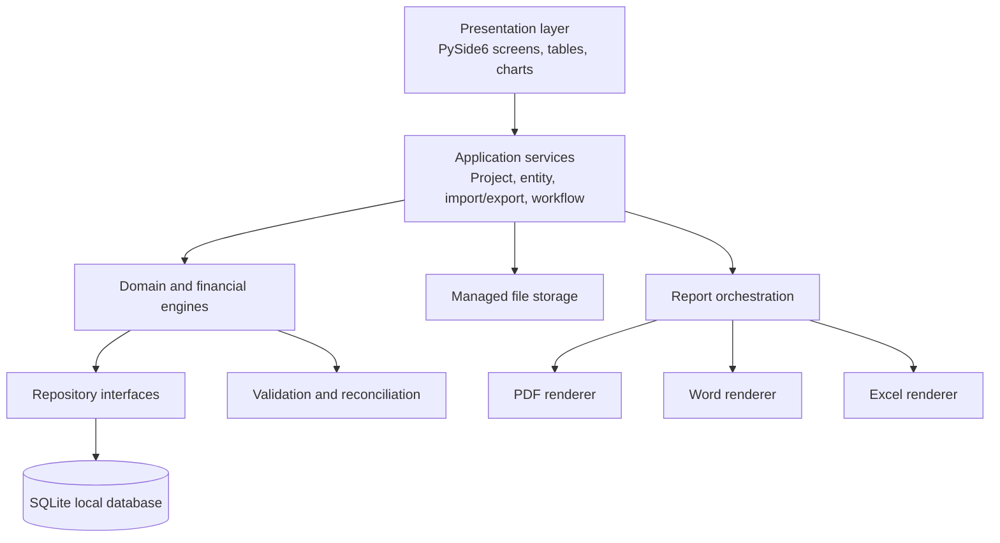
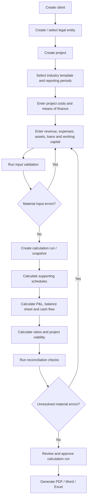
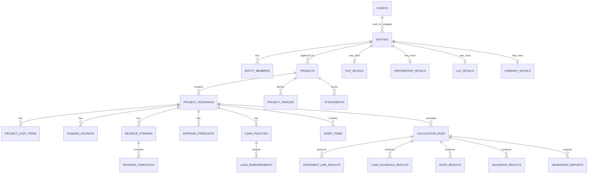
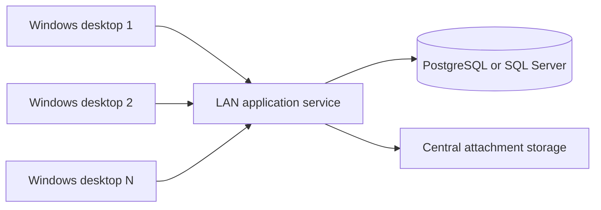

# Project Report Manager
## Technical Architecture & Database Schema — Review Draft 1.1

**Status:** Design for review only — no application code has been written
**Design update:** Seven-year projections by default; historical information hidden unless enabled; horizontal statement presentation  
**Approved direction:** Comprehensive application, developed in phases  
**Initial deployment:** Single-computer Windows desktop application  
**Future direction:** Multi-user deployment over a CA office LAN  
**Primary currency / jurisdiction for initial release:** INR / India, with dates, tax rules and reporting periods configurable

---

## 1. Purpose and design goals

Project Report Manager will be a professional desktop application for preparing project reports and integrated financial projections for different legal constitutions and business models. It is intended to support the full workflow from client and entity details through project costing, means of finance, operating assumptions, financial statements, loan schedules, ratios, appraisal analysis and professional report output.

The design has the following goals:

1. **One source of truth:** project inputs are entered once and reused across schedules, statements, ratios and reports.
2. **Entity-aware presentation:** Individual, Proprietorship, HUF, Partnership Firm, LLP and Private Limited Company are supported in the core design. Additional constitutions can be added without redesigning the project engine.
3. **Industry-neutral financial engine:** revenue and expense forecasting methods are configurable; industry templates supply sensible starting assumptions, not hard-coded accounting logic.
4. **Traceability:** each material assumption can retain its source, method, date and review note.
5. **Reproducibility:** every calculation run records the model-engine version and the input snapshot/hash used to generate the result.
6. **Financial integrity:** calculation logic is independent of the GUI, uses decimal arithmetic, and is covered by automated tests.
7. **Professional output:** PDF, Word and Excel reports share the same approved calculation results.
8. **Future LAN readiness:** the initial local database is not placed on a shared network folder. A future server-backed deployment will use a central database and application service.

## 2. Decisions proposed for approval

| Area | Proposed decision | Reason |
|---|---|---|
| Application style | Modular monolith | Easier to test and maintain than many small services; sufficient for a desktop product |
| GUI | PySide6 / Qt | Suitable for rich desktop forms, data grids, navigation, charts and keyboard workflows |
| Database access | SQLAlchemy 2.x repositories | Keeps business logic independent from the database dialect |
| Local database | SQLite on the local Windows drive | Simple installation and backup for a single-computer release |
| Schema migration | Alembic | Versioned database changes rather than manual table edits |
| Financial arithmetic | Python `Decimal` | Avoids binary floating-point errors in money calculations |
| Persistent money values | Integer minor units (paise) | Exact storage for INR amounts to two decimal places |
| Rates / quantities | Canonical decimal strings or scaled integers | Retains precision for rates, quantities, utilisation and percentages |
| Calculation outputs | Immutable calculation-run records | Preserves the exact basis of generated statements and reports |
| Projection horizon | 7 financial years by default; configurable per project | Reflects the normal project-reporting requirement while allowing shorter or longer projects |
| Historical information | Disabled / hidden by default; optional project-level activation | Avoids burdening new-project reports with unnecessary historical-data screens |
| Financial statement layout | Horizontal, year-wise columns | Matches common project-report presentation and allows direct year-wise review / Excel editing |
| PDF | ReportLab | Controlled page layout, headers, footers, tables and page breaks |
| Word | python-docx | Editable report output using reusable templates |
| Excel | XlsxWriter / openpyxl | Formula-driven workbooks and import/export support |
| Charts | Matplotlib initially; Plotly where interaction adds value | Static report charts and optional interactive application charts |
| Packaging | PyInstaller + Inno Setup | Windows executable and installer |

**Commercial distribution note:** PySide6 / Qt is dual-licensed. Before distributing a closed-source packaged application, the licence terms of Qt and every included dependency must be reviewed and documented. Qt describes its open-source and commercial licensing options in its official licensing guidance: https://www.qt.io/development/open-source-lgpl-obligations.

## 3. Logical application architecture



### 3.1 Presentation layer

Responsibilities:
- Display dashboard, project list, client/entity profiles and project workspaces.
- Capture and validate basic input format (required fields, date formats, numeric input).
- Present financial statements, schedules, ratios, charts and validation messages.
- Provide keyboard-friendly data grids, search, filters, copy/paste and Excel import.
- Never contain accounting formulas, tax calculations or loan-amortisation formulas.

Recommended UI pattern:
- `QMainWindow` for the application shell.
- A left navigation panel and central stacked workspace.
- Qt Model/View (`QTableView` with custom models/delegates) for schedules and statement grids.
- Separate dialogs for reusable master data and detailed input.
- `QThreadPool` / worker objects for lengthy imports, report generation and large recalculations so the GUI remains responsive.

### 3.2 Application service layer

Responsibilities:
- Orchestrate use cases such as Create Project, Duplicate Scenario, Import Historical Statements, Calculate Project, Validate Project and Generate Report.
- Coordinate transactions across repositories.
- Enforce project status and workflow rules.
- Prepare input bundles for the financial engine and save calculation results.

Example service boundaries:
- `ClientService`
- `EntityService`
- `ProjectService`
- `ScenarioService`
- `ProjectCostService`
- `FundingService`
- `ForecastService`
- `LoanService`
- `CalculationService`
- `ValidationService`
- `ReportService`
- `BackupService`

### 3.3 Domain / calculation layer

This layer contains deterministic functions and domain rules. It must not import PySide6, SQLAlchemy models or report-rendering libraries.

Proposed engines:
- Revenue forecasting engine
- Operating expense forecasting engine
- Project-cost and funding reconciliation engine
- Fixed-asset roll-forward and book-depreciation engine
- Separate tax-depreciation computation module
- Loan disbursement, interest and repayment engine
- Working-capital assessment engine
- Accounting / projected-statement engine
- Tax-provision engine
- Financial-ratio engine
- Break-even, payback, NPV and IRR engine
- Scenario and sensitivity engine
- Validation and reconciliation engine

Each engine receives typed inputs and returns typed outputs. Formula definitions should be maintained in code and unit-tested; explanatory formula descriptions can also be stored in the knowledge base. The application must not execute arbitrary formula text entered into the database.

### 3.4 Infrastructure layer

Responsibilities:
- SQLAlchemy models, database sessions and repository implementations.
- Alembic schema migrations.
- Local managed-file storage for quotations, approvals and supporting documents.
- Structured logs, crash logs and diagnostic exports.
- Backup and restore using a database-safe method.
- Configuration and dependency/version information.

### 3.5 Reporting layer

A report is generated from a selected **calculation run**, not directly from live form fields. This prevents a report from mixing old calculations with newly edited assumptions.

A shared `ReportDocument` / report-data object will supply the same approved content to:
- PDF renderer
- Editable Word renderer
- Excel financial-model renderer

Report templates will control section inclusion, order, heading styles, branding, page furniture, statement orientation, horizontal year columns and bank-specific formats. Templates must not independently recalculate financial figures. The standard financial statements will use the A:J horizontal layout described in Section 13, with landscape pages for wide PDF / Word tables. Historical sections remain excluded unless historical mode is enabled and the user selects them.

## 4. Project and calculation lifecycle



### 4.1 Default projection and optional historical-data workflow

**Default behaviour for a new project:**
- Generate seven annual projection periods (Project Year 1 through Project Year 7).
- Derive the actual financial-year labels from the selected projection commencement financial year.
- Do not create historical-period rows unless the user enables historical information.
- Hide historical-data navigation, historical input forms, import controls and historical report sections while the option is off.
- Keep the projection horizon configurable (recommended choices: 3, 5, 7, 10 years and a custom value, subject to a sensible application limit). Changing the horizon regenerates the visible period grid but must not delete prior inputs or calculation runs without confirmation.

**Optional historical mode:**
- An explicit project setting, `historical_data_enabled`, reveals historical statement entry / import screens.
- The user can select the number of historical years and enter or import the available P&L, balance sheet and cash-flow figures.
- Historical periods are stored separately from projected periods and are not silently blended into projection calculations.
- Historical information is omitted from the generated report unless the relevant report section is selected.
- New projects can remain entirely projection-only; expansion / existing-business projects can activate historical mode when required by the lender or report purpose.

### 4.2 Project statuses

Proposed statuses:
- `DRAFT`
- `INPUT_IN_PROGRESS`
- `READY_FOR_CALCULATION`
- `CALCULATED`
- `UNDER_REVIEW`
- `APPROVED_FOR_REPORT`
- `REPORT_GENERATED`
- `ARCHIVED`

A status is a workflow indicator, not a substitute for professional review.

### 4.3 Scenario lifecycle

Each project can contain one or more scenarios, such as:
- Base Case
- Conservative Case
- Optimistic Case
- Bank-Appraisal Case
- User-defined Case

Scenarios share project identity, location and the same seven default projection periods (or the project-configured horizon) but can have their own revenue, expense, capex, funding and operating assumptions. Historical periods are shared only when historical mode is enabled. A scenario can optionally be copied from another scenario and then independently edited.

### 4.4 Calculation-run immutability

When Calculate is selected:
1. The application validates the current input set.
2. It creates a calculation-run header containing scenario, engine version, timestamp and input fingerprint.
3. It builds a complete, read-only input bundle.
4. The engines calculate schedules and statements using `Decimal` values.
5. Results and validation messages are saved against the run.
6. The run is not edited in place. A subsequent recalculation creates a new run.

This supports reproducibility and makes it possible to identify which report came from which model assumptions.

## 5. Data design principles

1. Primary keys use UUIDs. This is useful for future synchronisation and avoids dependence on database-specific integer IDs.
2. Table and column names use `snake_case`.
3. All principal records carry `created_at` and `updated_at`; `created_by` / `updated_by` are nullable in the first local release and can be populated when user accounts are introduced.
4. Financial records should be archived, not casually deleted. Foreign keys use restrictive delete rules for completed projects and calculation runs.
5. INR monetary values are calculated using `Decimal` and stored as integer paise (`*_paise` BIGINT). Display and reports convert paise to rupees.
6. Unit rates, quantities, percentages and ratios are stored as canonical decimal strings or scaled integers, never binary floats.
7. Dates use ISO date values. Timestamps are stored in UTC.
8. The database stores inputs separately from calculated outputs.
9. Lookup codes are stable machine codes; labels can be changed without breaking formulas.
10. Every important assumption should be capable of recording its source, method, unit, preparer note and review status.

## 6. Entity model

### 6.1 Supported constitution codes

| Code | Display name | Key information / presentation needs |
|---|---|---|
| `INDIVIDUAL` | Individual | Individual identity and capital / funds introduced |
| `PROPRIETORSHIP` | Sole proprietorship | Proprietor identity, proprietor capital and drawings |
| `HUF` | Hindu Undivided Family | HUF PAN, Karta and member details, HUF capital |
| `PARTNERSHIP` | Partnership firm | Deed, partners, profit-sharing ratio, capital/current accounts |
| `LLP` | Limited Liability Partnership | LLPIN, designated partners, contribution and partner accounts |
| `PRIVATE_LIMITED` | Private Limited Company | CIN, directors, shareholders, share capital and reserves |

The schema should allow later codes such as `PUBLIC_LIMITED`, `TRUST`, `SOCIETY`, `AOP` and `OTHER` without changing the project tables.

### 6.2 Entity-person roles

`entity_members` will support role codes such as:
- `INDIVIDUAL_APPLICANT`
- `PROPRIETOR`
- `KARTA`
- `COPARCENER`
- `PARTNER`
- `DESIGNATED_PARTNER`
- `DIRECTOR`
- `SHAREHOLDER`
- `PROMOTER`
- `AUTHORISED_SIGNATORY`

The entity-member record may contain profit share, capital commitment or shareholding percentage where relevant. Entity-specific constraints are validated by the entity service; for example, partner profit shares should be reviewed for reconciliation rather than assumed to total 100% without confirmation.

## 7. Proposed database schema

The schema below is the proposed logical schema for the first comprehensive release. Lookup tables and some reporting tables may be split or combined during implementation, but their responsibilities should remain identifiable.

### 7.1 Client and legal-entity tables

| Table | Important columns | Purpose / rules |
|---|---|---|
| `clients` | `id PK`, `client_code UNIQUE`, `display_name`, `client_category`, `phone`, `email`, `address_text`, `notes`, timestamps | CA-firm client / customer record. A client may own more than one legal entity. |
| `entities` | `id PK`, `client_id FK`, `constitution_code`, `legal_name`, `trade_name`, `business_description`, `accounting_framework_code`, `tax_profile_code`, `active_flag`, timestamps | The legal applicant / business entity used by a project. |
| `entity_identifiers` | `id PK`, `entity_id FK`, `identifier_type`, `identifier_value`, `valid_from`, `valid_to`, `verification_status`, `source_attachment_id FK NULL` | PAN, GSTIN, TAN, CIN, LLPIN, Udyam and other IDs. Unique rule on identifier type/value where appropriate. |
| `entity_members` | `id PK`, `entity_id FK`, `full_name`, `role_code`, `pan_encrypted NULL`, `address_text`, `profit_share_pct_text NULL`, `shareholding_pct_text NULL`, `capital_commitment_paise NULL`, `date_from`, `date_to`, `notes` | Karta, partners, designated partners, directors, shareholders, proprietor and other persons. Sensitive identifiers should be protected and access should be limited. |
| `huf_details` | `entity_id PK/FK`, `karta_member_id FK`, `huf_formation_note`, `notes` | HUF-specific extension. Karta must belong to the same entity. |
| `partnership_details` | `entity_id PK/FK`, `deed_date`, `registration_status`, `governing_deed_attachment_id FK NULL`, `notes` | Partnership-specific extension. Partner details remain in `entity_members`. |
| `llp_details` | `entity_id PK/FK`, `incorporation_date`, `llp_agreement_date`, `agreement_attachment_id FK NULL`, `notes` | LLP-specific extension. LLPIN is stored in `entity_identifiers`. |
| `company_details` | `entity_id PK/FK`, `incorporation_date`, `company_class`, `authorised_capital_paise`, `paid_up_capital_paise`, `registered_office_address`, `notes` | Company-specific extension. CIN is stored in `entity_identifiers`. |
| `proprietorship_details` | `entity_id PK/FK`, `proprietor_member_id FK`, `business_start_date`, `notes` | Links a proprietorship to the proprietor record in `entity_members`. |

**Individual constitution:** an individual applicant can use `entities` with `constitution_code = INDIVIDUAL`; entity-specific tax and personal details should only be collected where required for the particular project/report. Avoid collecting unnecessary personal information.

### 7.2 Project, period and scenario tables

| Table | Important columns | Purpose / rules |
|---|---|---|
| `projects` | `id PK`, `entity_id FK`, `project_code`, `project_name`, `industry_code`, `business_model_code`, `project_nature_code`, `location_address`, `district`, `state`, `pin_code`, `project_description`, `implementation_start`, `commercial_operation_date`, `currency_code`, `projection_granularity`, `projection_year_count DEFAULT 7`, `projection_start_financial_year`, `historical_data_enabled DEFAULT FALSE`, `historical_year_count NULL`, `statement_layout_code DEFAULT HORIZONTAL_YEAR_COLUMNS`, `status_code`, timestamps | Main project record. Unique project code within the application. Default creates seven projected financial years and no historical periods. Historical inputs are only exposed when explicitly enabled. |
| `project_scenarios` | `id PK`, `project_id FK`, `scenario_code`, `scenario_name`, `scenario_type`, `parent_scenario_id FK NULL`, `probability_pct_text NULL`, `is_default`, `notes`, timestamps | Base, conservative, optimistic and custom scenarios. Unique scenario code per project. |
| `project_periods` | `id PK`, `project_id FK`, `period_sequence`, `period_role`, `period_granularity`, `period_label`, `period_type`, `start_date`, `end_date`, `financial_year_label`, `display_sequence`, `is_report_column` | Normalised reporting periods. Default: seven annual `PROJECTION` periods, sequence 1–7. Create `HISTORICAL` periods only when `historical_data_enabled = TRUE`. Monthly loan instalments remain in the loan schedule and do not create extra annual statement columns. Validate no unintended overlapping periods. |
| `project_participants` | `id PK`, `project_id FK`, `entity_member_id FK NULL`, `participant_name`, `project_role`, `responsibility_note`, `experience_summary` | Captures project-specific promoter / technical / managerial roles. Can reference an entity member or an external person. |
| `project_assumptions` | `id PK`, `scenario_id FK`, `period_id FK NULL`, `assumption_code`, `value_type`, `value_decimal_text NULL`, `value_text NULL`, `unit_code`, `projection_method`, `source_id FK NULL`, `preparer_note`, `review_status` | Flexible supplementary assumptions not covered by dedicated forecast tables. Use stable assumption codes; do not use this table as a replacement for core structured data. |

### 7.3 Source, attachment and audit tables

| Table | Important columns | Purpose / rules |
|---|---|---|
| `project_sources` | `id PK`, `project_id FK`, `source_type`, `source_title`, `source_party`, `source_date`, `source_reference`, `verification_status`, `review_note` | Records where an assumption came from: vendor quote, bank term sheet, promoter estimate, government source, market study etc. |
| `attachments` | `id PK`, `project_id FK`, `source_id FK NULL`, `file_category`, `original_filename`, `stored_relative_path`, `mime_type`, `file_size`, `sha256_hash`, `uploaded_at`, `notes` | Stores file metadata. Actual file is placed in managed project storage, not embedded in the database. |
| `audit_events` | `id PK`, `project_id FK NULL`, `entity_id FK NULL`, `event_type`, `record_type`, `record_id`, `before_json`, `after_json`, `event_timestamp`, `actor_label` | Records material changes, imports, calculation runs, overrides and report generation. Avoid logging secrets or full sensitive identifiers. |

### 7.4 Project cost and funding tables

| Table | Important columns | Purpose / rules |
|---|---|---|
| `project_cost_heads` | `id PK`, `head_code UNIQUE`, `head_name`, `category_code`, `capitalisation_default`, `sort_order`, `active_flag` | Seeded editable cost-head library: land, building, plant, electrical, deposits, pre-operative costs etc. |
| `project_cost_items` | `id PK`, `scenario_id FK`, `cost_head_id FK`, `description`, `quantity_decimal_text NULL`, `unit_code NULL`, `rate_decimal_text NULL`, `basic_amount_paise`, `gst_rate_text NULL`, `gst_amount_paise`, `eligible_itc_paise`, `capitalised_amount_paise`, `payment_due_date NULL`, `source_id FK NULL`, `notes` | Detailed item-wise project costs. ITC, non-creditable GST and capitalised amount are separately represented. Calculations must reconcile to the invoice / estimate. |
| `funding_heads` | `id PK`, `funding_code UNIQUE`, `funding_name`, `funding_category`, `sort_order`, `active_flag` | Promoter contribution, share capital, partner capital, term loan, subsidy, unsecured loan, working-capital facility etc. |
| `funding_sources` | `id PK`, `scenario_id FK`, `funding_head_id FK`, `source_name`, `amount_paise`, `expected_date NULL`, `loan_facility_id FK NULL`, `source_id FK NULL`, `terms_note`, `notes` | Means of finance. Total sources are reconciled with total project uses. Loan facilities are linked where the source represents a loan. |

### 7.5 Revenue and operating-expense tables

| Table | Important columns | Purpose / rules |
|---|---|---|
| `revenue_methods` | `method_code PK`, `method_name`, `description`, `active_flag` | Examples: capacity × utilisation, units × price, customers × average bill, beds × occupancy, rental units × rate, turnover growth, manual input. |
| `revenue_streams` | `id PK`, `scenario_id FK`, `stream_code`, `stream_name`, `method_code FK`, `unit_code`, `gst_treatment_code`, `active_flag`, `notes` | Multiple revenue streams can be defined for one project. |
| `revenue_forecasts` | `id PK`, `revenue_stream_id FK`, `period_id FK`, `capacity_decimal_text NULL`, `utilisation_pct_text NULL`, `units_decimal_text NULL`, `price_per_unit_decimal_text NULL`, `growth_pct_text NULL`, `manual_revenue_paise NULL`, `calculation_mode`, `source_id FK NULL`, `notes` | Stores the drivers for each period. Revenue is calculated by the engine; manual override is explicit and traceable. Unique stream/period combination. |
| `expense_heads` | `id PK`, `expense_code UNIQUE`, `expense_name`, `expense_group`, `default_cost_behaviour`, `default_projection_method`, `active_flag` | Fixed, variable and semi-variable expense library. |
| `expense_forecasts` | `id PK`, `scenario_id FK`, `expense_head_id FK`, `period_id FK`, `projection_method`, `base_amount_paise NULL`, `growth_pct_text NULL`, `revenue_pct_text NULL`, `unit_cost_decimal_text NULL`, `quantity_driver_code NULL`, `manual_amount_paise NULL`, `source_id FK NULL`, `notes` | Supports fixed amount, growth, percentage of revenue, per-unit, capacity and manual methods. Engine validates required parameters for the selected method. |

### 7.6 Fixed assets and depreciation tables

| Table | Important columns | Purpose / rules |
|---|---|---|
| `asset_categories` | `id PK`, `asset_code UNIQUE`, `asset_name`, `default_useful_life_years_text NULL`, `active_flag` | Charger, plant, building, furniture, vehicle, computer, electrical installation etc. Defaults are prompts, not legal conclusions. |
| `asset_items` | `id PK`, `scenario_id FK`, `asset_category_id FK`, `asset_name`, `asset_description`, `vendor_name NULL`, `source_id FK NULL`, `notes` | Asset register entry / planned asset. |
| `asset_additions` | `id PK`, `asset_item_id FK`, `period_id FK`, `gross_addition_paise`, `eligible_itc_paise`, `capitalised_amount_paise`, `put_to_use_date NULL`, `useful_life_years_text NULL`, `book_depreciation_method`, `book_residual_value_paise`, `tax_block_code NULL`, `notes` | Asset-wise additions and depreciation inputs. Book and tax depreciation are kept distinct. |
| `depreciation_policies` | `id PK`, `scenario_id FK`, `asset_category_id FK`, `policy_type`, `method_code`, `rate_pct_text NULL`, `useful_life_years_text NULL`, `effective_from`, `effective_to NULL`, `source_reference NULL`, `review_status` | Versioned accounting / tax depreciation assumptions. Tax rates should be sourced and reviewed for the relevant financial year. |

### 7.7 Loan and working-capital tables

| Table | Important columns | Purpose / rules |
|---|---|---|
| `loan_facilities` | `id PK`, `scenario_id FK`, `facility_code`, `lender_name`, `loan_type`, `sanctioned_amount_paise`, `interest_rate_pct_text`, `rate_type`, `rate_reset_note NULL`, `repayment_method`, `repayment_frequency`, `tenure_count`, `moratorium_count`, `first_disbursement_date NULL`, `first_repayment_date NULL`, `processing_fee_paise`, `interest_basis`, `source_id FK NULL`, `notes` | Multiple facilities per project. Supports EMI, equal principal, interest-only / moratorium and custom schedules. |
| `loan_disbursements` | `id PK`, `loan_facility_id FK`, `disbursement_date`, `amount_paise`, `source_id FK NULL`, `notes` | Supports staged disbursements. Total drawdown must be checked against sanctioned amount. |
| `loan_repayment_overrides` | `id PK`, `loan_facility_id FK`, `installment_number`, `due_date`, `principal_override_paise NULL`, `interest_override_paise NULL`, `total_payment_override_paise NULL`, `reason`, `source_id FK NULL` | Optional custom repayment / lender-confirmed overrides. Every override requires a reason and must reconcile. |
| `working_capital_assumptions` | `id PK`, `scenario_id FK`, `period_id FK`, `component_code`, `holding_days_text NULL`, `turnover_percentage_text NULL`, `amount_override_paise NULL`, `basis_code`, `source_id FK NULL`, `notes` | Inventory, receivable, creditor, expense and cash-cycle assumptions. Supports operating-cycle and percentage-of-turnover methods. |

### 7.8 Historical financial data and tax configuration

| Table | Important columns | Purpose / rules |
|---|---|---|
| `historical_statement_lines` | `id PK`, `project_id FK`, `period_id FK`, `statement_type`, `line_code`, `line_label`, `amount_paise`, `source_id FK NULL`, `is_imported`, `notes` | Optional historical P&L, balance sheet and cash-flow data. This table remains available in the schema, but the historical-data UI and import workflow are hidden unless the project-level option is enabled. Store source and mapping details. |
| `tax_profiles` | `id PK`, `scenario_id FK`, `entity_type_code`, `financial_year_label`, `tax_regime_code`, `effective_tax_rate_text NULL`, `surcharge_rate_text NULL`, `cess_rate_text NULL`, `loss_brought_forward_paise`, `tax_override_note`, `source_reference`, `review_status` | Project tax assumptions. Does not replace a complete income-tax return computation. Rates must be reviewed for the relevant entity and year. |
| `tax_rule_versions` | `id PK`, `rule_code`, `jurisdiction`, `entity_type_code`, `effective_from`, `effective_to NULL`, `rule_value_text`, `source_title`, `source_url`, `verified_on`, `verified_by_label`, `status` | Versioned reference rules for future supported tax calculations. No silent automatic update of a previously approved project. |

### 7.9 Calculation outputs and validation tables

| Table | Important columns | Purpose / rules |
|---|---|---|
| `calculation_runs` | `id PK`, `project_id FK`, `scenario_id FK`, `run_number`, `engine_version`, `input_hash`, `run_timestamp`, `run_status`, `prepared_by_label`, `summary_note` | Immutable record of each calculation attempt. Unique run number within a scenario. |
| `statement_line_results` | `id PK`, `calculation_run_id FK`, `period_id FK`, `statement_type`, `line_code`, `line_label_snapshot`, `amount_paise`, `formula_reference`, `trace_json` | P&L, balance sheet and cash-flow line results. Unique run/period/statement/line. |
| `loan_schedule_results` | `id PK`, `calculation_run_id FK`, `loan_facility_id FK`, `installment_number`, `due_date`, `opening_balance_paise`, `payment_paise`, `interest_paise`, `principal_paise`, `closing_balance_paise` | Complete amortisation output for each run. |
| `asset_schedule_results` | `id PK`, `calculation_run_id FK`, `asset_item_id FK`, `period_id FK`, `opening_gross_paise`, `additions_paise`, `disposals_paise`, `closing_gross_paise`, `depreciation_paise`, `accumulated_depreciation_paise`, `closing_nbv_paise` | Fixed-asset roll-forward and book depreciation results. |
| `ratio_results` | `id PK`, `calculation_run_id FK`, `period_id FK`, `ratio_code`, `numerator_value_text`, `denominator_value_text`, `ratio_value_text`, `interpretation_code`, `benchmark_note` | Ratio results and their numerator / denominator for traceability. |
| `validation_results` | `id PK`, `calculation_run_id FK`, `rule_code`, `severity`, `scope_code`, `message`, `expected_value_text NULL`, `actual_value_text NULL`, `resolution_status`, `override_reason NULL` | Error, warning and information messages. Material overrides must be documented. |

### 7.10 Knowledge base, templates and reports

| Table | Important columns | Purpose / rules |
|---|---|---|
| `knowledge_categories` | `id PK`, `category_code UNIQUE`, `category_name`, `parent_id FK NULL`, `sort_order` | Project report concepts, accounting, loans, ratios, working capital, tax and industry methods. |
| `knowledge_articles` | `id PK`, `category_id FK`, `title`, `body_markdown`, `jurisdiction`, `effective_from NULL`, `effective_to NULL`, `source_id FK NULL`, `reviewed_on`, `review_status` | Explanations, techniques, examples and source-backed professional notes. |
| `formula_definitions` | `id PK`, `formula_code UNIQUE`, `formula_name`, `formula_text`, `purpose`, `limitations`, `source_id FK NULL`, `review_status` | Human-readable formulas and interpretations; not executable code. |
| `industry_templates` | `id PK`, `industry_code UNIQUE`, `industry_name`, `description`, `template_version`, `active_flag` | Industry starter templates. |
| `industry_template_fields` | `id PK`, `industry_template_id FK`, `module_code`, `field_code`, `field_label`, `input_type`, `unit_code`, `required_flag`, `default_value_text NULL`, `help_text`, `sort_order` | Dynamic industry-specific inputs and guidance. |
| `report_templates` | `id PK`, `template_code UNIQUE`, `template_name`, `output_type`, `entity_type_code NULL`, `bank_name NULL`, `template_version`, `layout_profile_id FK NULL`, `active_flag` | Generic, entity-aware and bank-specific output templates. Financial-statement templates use a horizontal year-column layout by default. |
| `report_template_sections` | `id PK`, `report_template_id FK`, `section_code`, `section_title`, `sort_order`, `default_included`, `required_flag`, `renderer_key` | Controls report structure and section inclusion. Historical-information sections are excluded by default and become available when historical data is enabled. |
| `report_layout_profiles` | `id PK`, `layout_code UNIQUE`, `layout_name`, `orientation`, `default_period_columns`, `show_serial_column`, `show_note_reference_column`, `particulars_column_width`, `period_column_width`, `freeze_leading_columns`, `active_flag` | Controls horizontal financial-statement layout across PDF, Word and Excel outputs. Default is landscape with a particulars column followed by seven period columns. |
| `report_layout_columns` | `id PK`, `layout_profile_id FK`, `column_sequence`, `column_role`, `column_label`, `width_weight`, `visible_by_default` | Defines leading columns and period columns. Default roles: serial number (A), note / schedule reference (B), particulars (C), and projection periods 1–7 (D:J). Actual financial-year labels are populated from `project_periods`. |
| `generated_reports` | `id PK`, `project_id FK`, `scenario_id FK`, `calculation_run_id FK`, `report_template_id FK`, `output_type`, `stored_relative_path`, `file_hash`, `generated_at`, `generated_by_label`, `report_version` | Metadata for generated PDF, Word and Excel files. The calculation run is mandatory. |

### 7.11 System / migration support

| Table / mechanism | Purpose |
|---|---|
| Alembic version table | Records schema migration revision. |
| `application_settings` | Local UI preferences, file paths, default report settings and app configuration; no secrets in plain text. |
| `backup_history` | Backup file path, timestamp, size, hash, result and restore test information. |
| `app_users` (later phase) | Local operator identities and future multi-user authentication references. Not required for a role-heavy first release. |

## 8. Key relationships



## 9. Financial engine design

### 9.1 Calculation order

The proposed dependency order is:

1. Validate project periods, project cost inputs and means of finance.
2. Calculate revenue by stream and period.
3. Calculate variable, fixed and semi-variable operating expenses.
4. Calculate asset additions, capitalisation, book depreciation and asset closing balances.
5. Calculate loan disbursements, interest, principal and closing balances.
6. Calculate working capital requirements and movements.
7. Calculate EBITDA, EBIT, PBT, tax provision and PAT.
8. Generate projected cash flow.
9. Generate projected balance sheet and retained earnings / capital movements.
10. Reconcile balance sheet, cash movement, loans, fixed assets and funding.
11. Calculate ratios, DSCR, break-even, payback, NPV and IRR.
12. Store outputs and validation results against the calculation run.

### 9.2 No circular formulas in the first release

The first release should avoid opaque spreadsheet-style circular calculations. Where interest depends on average debt or cash, the selected method must be explicit and deterministic. Any iterative calculation should have a documented convergence rule, maximum iterations and a visible result status.

### 9.3 Decimal and rounding policy

- Use `Decimal` for all financial arithmetic.
- Convert user input strings directly to `Decimal`; do not create `Decimal` from a Python float.
- Store rupee amounts as integer paise at the persistence boundary.
- Apply rounding at defined boundaries (for example, instalment interest, tax provision and statement presentation), with the chosen rounding convention documented.
- Keep full calculation precision internally where appropriate; present rupees to two decimal places unless a report format requires whole rupees or lakhs.
- Record the rounding policy and engine version in the calculation run.

### 9.4 Separate accounting and tax treatments

The model must distinguish:
- Book depreciation from tax depreciation.
- Accounting profit from taxable income.
- Output GST from revenue.
- Eligible input tax credit from non-creditable tax capitalised into cost.
- Loan principal from finance cost.
- Cash available for debt service from accounting PAT.

Tax computations in the initial release should be clearly labelled as project-level estimates based on reviewed parameters. They should not be represented as a complete return computation or automatically treated as legal advice.

### 9.5 Entity-specific statements

The same engine should produce common financial facts while the presentation mapper changes the displayed format based on constitution and selected reporting framework.

Examples:
- Proprietorship: proprietor's capital, drawings and current account presentation.
- HUF: HUF capital and relevant member/Karta details.
- Partnership: partner-wise capital/current accounts and profit appropriation.
- LLP: partners' contribution/current accounts and allocation based on the LLP agreement.
- Company: share capital, reserves and surplus, borrowings and Schedule III-oriented presentation where selected.

The mapping must not assume that every entity follows the same presentation or statutory requirements. The selected accounting/reporting framework and effective date must be recorded.

## 10. Validation framework

Each validation rule should have a stable code, severity, explanation and resolution path.

### 10.1 Error — blocks approval for report

Examples:
- Total project cost does not reconcile to means of finance and no funding gap is disclosed.
- Balance sheet does not balance.
- Loan opening balance less principal does not equal closing balance.
- Principal repayment exceeds outstanding principal.
- Cash-flow closing cash does not agree with balance-sheet cash.
- Retained earnings / capital movement does not reconcile to the result and distributions.
- Duplicate reporting periods or invalid date ranges.
- Required parameters for a selected forecasting method are missing.

### 10.2 Warning — review required

Examples:
- Working capital assumptions are zero or incomplete.
- Project cost excludes a vendor item stated as “actuals”.
- GST credit treatment has not been confirmed.
- Depreciation useful life / method is not supported by a reviewed policy.
- Loan repayment begins before commercial operations.
- Promoter contribution is not supported by a source document.
- Revenue assumptions exceed stated capacity.
- Bank charges, fixed electricity charges, rent or CAMC are not quantified.

### 10.3 Information — disclosure prompt

Examples:
- First projection year is a partial year.
- Report uses a vendor quotation dated before the report date.
- A user override was applied.
- Sensitivity analysis is based on illustrative assumptions.

An override must capture who approved it, when, why and which validation rule was overridden.

## 11. File storage, backup and recovery

### 11.1 Proposed local folder layout

```text
%LOCALAPPDATA%\ProjectReportManager\
│
├── database\
│   └── project_report_manager.db
├── projects\
│   └── <project_uuid>\
│       ├── attachments\
│       ├── generated_reports\
│       └── working_files\
├── templates\
│   ├── pdf\
│   ├── word\
│   └── excel\
├── backups\
├── logs\
└── config\
```

### 11.2 Backup design

- Provide manual Backup Now and Restore Backup functions.
- Provide configurable automatic local backups.
- Use SQLite's online backup mechanism or a controlled close-and-copy process; do not casually copy a live database file while transactions are active.
- Keep a configurable number of dated backups.
- Include managed attachments and template customisations in the backup package.
- Store a manifest with database schema version, application version, creation time and file hashes.
- Provide a backup verification / restore test procedure.
- Make the backup location configurable, including an external drive or approved cloud-synchronised folder. Avoid putting the live SQLite database itself inside a synchronised or shared folder.

## 12. Future LAN architecture

The first release is single-user and local. It should not attempt concurrent access by multiple desktops to the same SQLite file over a network share.

For a future multi-user release, the recommended target is:



Future migration principles:
1. Keep GUI calls behind application service interfaces.
2. Keep database operations behind repositories.
3. Use UUIDs and explicit migrations from the beginning.
4. Introduce a LAN API service (for example, FastAPI) rather than letting every desktop connect directly to a shared database file.
5. Add user authentication, permissions, project locking / optimistic concurrency and audit identity when multi-user access is introduced.
6. Move attachments to controlled server storage with backup and access policies.
7. Test concurrent edits, failed network calls, transaction rollback and backup/restore.

The initial product need not include the API server, but the service/repository boundaries should make it possible to add one later.

## 13. Financial statement presentation and horizontal year-wise layout

The default presentation for the projected Profit & Loss Account, Balance Sheet, Cash Flow Statement and supporting annual schedules is **horizontal / year-wise**. The particulars are listed vertically and each projected financial year is presented in a separate column.

### 13.1 Default column structure

| Excel column | Default content | Behaviour |
|---|---|---|
| A | Sr. No. | Optional row numbering; can be hidden for selected schedules |
| B | Note / Schedule Ref. | Optional cross-reference to a supporting schedule or annexure |
| C | Particulars | Main description column; wider than the year columns |
| D | Project Year 1 | First projected financial year |
| E | Project Year 2 | Second projected financial year |
| F | Project Year 3 | Third projected financial year |
| G | Project Year 4 | Fourth projected financial year |
| H | Project Year 5 | Fifth projected financial year |
| I | Project Year 6 | Sixth projected financial year |
| J | Project Year 7 | Seventh projected financial year |

The actual financial-year headings (for example, FY 2027-28 through FY 2033-34) will be generated from the project's projection commencement year. The labels “Project Year 1” to “Project Year 7” may appear as a secondary label or in the column heading where useful. The number of year columns follows the configured projection horizon; seven is the default.

### 13.2 Layout behaviour in each output

- **Excel:** Use the A:J arrangement above by default. Freeze the heading rows and leading columns A:C; enable filters where appropriate; use consistent number formats; keep totals and subtotals visually distinct; allow copy/paste of year-wise ranges. The workbook should not use a separate sheet per year for the core statements.
- **PDF:** Use landscape pages for wide financial statements and schedules. Repeat the table heading row on continuation pages, keep the particulars column readable and avoid shrinking all text excessively just to force a table onto one page.
- **Word:** Use landscape section orientation for wide financial statements, retaining the same logical column order as Excel. Narrative sections can remain portrait.
- **GUI:** Display financial statements and year-wise input schedules as spreadsheet-like grids. Keep the particulars column visible while scrolling horizontally through periods.

### 13.3 Internal storage remains normalised

The database must **not** add hard-coded columns such as `year_1_amount` through `year_7_amount` to every financial table. Store one record per statement line and reporting period, keyed by `calculation_run_id`, `period_id`, `statement_type` and `line_code`. The report / GUI presentation layer pivots those normalised records into the horizontal A:J grid. This preserves the seven-year default while allowing a 3-, 5-, 10-year or custom projection and optional monthly / quarterly analysis without redesigning the database.

### 13.4 Period and column mapping

- `project_periods.period_sequence` identifies the chronological sequence (1 to 7 for the standard horizon).
- `project_periods.period_role` distinguishes `PROJECTION` from optional `HISTORICAL` periods.
- `project_periods.display_sequence` determines the order of visible year columns.
- `report_layout_columns` defines the leading A:C columns and the period-column role.
- Report generation maps projected periods into D:J in chronological order and uses the financial-year label as the visible heading.
- When historical mode is enabled and a report template requests historical comparisons, historical periods can be placed before projection years using a separate layout profile. The default project-report layout remains projection-first and seven-year.

## 14. Report-generation design

### 14.1 Report data pipeline

`CalculationRun` → `ReportDataBuilder` → `ReportDocument` → selected renderer → output file.

### 14.2 Output types

**PDF**
- Controlled pagination, headers, footers and page numbering.
- Executive summary, financial tables, charts and annexures.
- Repeated table headings across pages and avoidance of split totals where practical.

**Word**
- Editable narrative and tables.
- Styles, headings, tables of contents, headers and footers.
- Firm branding and reusable content blocks.

**Excel**
- Assumptions sheet.
- Project cost and means of finance.
- Revenue and expense projections.
- Fixed asset / depreciation schedule.
- Loan repayment schedule.
- Projected P&L, balance sheet and cash flow.
- Ratios, DSCR and scenario comparison.
- Formula/source notes and checks.

### 14.3 Report integrity

Every generated report stores its project, scenario, calculation-run ID, template ID, report version and file hash. If assumptions change later, the previous report remains associated with the earlier calculation run.

## 15. Testing strategy

### 15.1 Unit tests

- EMI and reducing-balance loan calculations.
- Equal-principal and moratorium schedules.
- Loan balance reconciliation.
- Revenue methods and escalation.
- Expense forecasting methods.
- Book depreciation methods.
- GST / ITC project-cost treatment.
- Working-capital calculations.
- Tax provision parameter handling.
- Cash-flow calculations.
- Retained earnings and balance-sheet reconciliation.
- DSCR, interest coverage, NPV, IRR and break-even.

### 15.2 Integration tests

- Input records → calculation run → statements → validation results.
- Multiple loans feeding finance cost and balance sheet.
- Multiple revenue streams and expense heads.
- Scenario copy and scenario comparison.
- PDF / Word / Excel outputs agreeing to the same calculation run.
- Database migration from one schema version to the next.
- Backup and restore including attachments.

### 15.3 Acceptance test projects

The following projects should be used as a test library, not as hard-coded application logic:

| Test project | Constitution | Main calculations to test |
|---|---|---|
| EV charging station | LLP | Sessions × kWh × tariff, platform fee, power cost and term loan |
| Rice mill | Partnership | Capacity utilisation, raw materials, inventory and partner accounts |
| Retail trading business | Proprietorship | Purchases, inventory, gross margin and working capital |
| Hospital | Private Limited | Beds, occupancy, multiple income streams and fixed assets |
| Restaurant | Individual / Proprietorship | Covers, average bill, operating days and variable expenses |
| Rental property | HUF | Occupancy, rentals, deposits and property costs |
| IT services | LLP | Headcount, billing rates, utilisation and payroll |
| Factory expansion | Private Limited | Existing financials, incremental capex and additional borrowing |

For each sample, independently verified expected results should be maintained as test fixtures.

## 16. Development phases and proposed deliverables

| Phase | Scope | Exit criteria |
|---|---|---|
| 1. Foundation | App shell, navigation, client/entity/project management, SQLite, migrations, backup, settings | Project can be created, saved, reopened and backed up |
| 2. Inputs | Project cost, funding, seven-year periods, revenue, expenses, industry templates; optional historical-data mode and import | Inputs can be entered, sourced and validated; historical screens remain hidden unless enabled |
| 3. Financial engine | Fixed assets, depreciation, loans, working capital, tax parameters, P&L, balance sheet and cash flow | Integrated statements reconcile against tested cases |
| 4. Appraisal | Ratios, DSCR, break-even, payback, NPV, IRR, scenarios and sensitivities | Ratios and appraisal results reconcile to independent calculations |
| 5. Outputs | PDF, Word, Excel, report templates, charts and annexures | All three outputs agree to one selected calculation run |
| 6. Hardening | Acceptance tests, packaging, installer, backup/restore, documentation and sample projects | Installable Windows build passes acceptance testing |
| 7. LAN expansion (later) | API service, server database, authentication, concurrency and central file store | Multiple clients pass concurrent-use and recovery tests |

## 17. Items requiring a design decision before implementation

The following are the only significant choices that should be confirmed before the first coding phase. Recommended defaults are shown.

| Decision | Recommended default | Why it matters |
|---|---|---|
| Initial reporting basis | Bank-oriented project report, with entity-aware formats; company Schedule III-style presentation selectable | Avoids falsely treating every project report as a statutory financial statement |
| Default projection period | 7 financial years; allow 3 / 5 / 10 / custom years | Seven-year horizon is the normal project-report default; other horizons remain available per project |
| Projection granularity | Annual statements for seven years; monthly loan schedules; monthly / quarterly operational projection optional | Keeps the main project report readable while retaining detailed schedules |
| Historical data | Off and hidden by default; optional activation for existing / expansion projects, with a configurable number of years | Avoids collecting historical information where it is not normally required |
| Tax module | Configurable estimate with effective-date/source reference; no claim of complete tax-return computation | Statutory tax logic needs separate verification and maintenance |
| Financial statement layout | Horizontal year-wise layout; A = Sr. No., B = Note / Schedule Ref., C = Particulars, D:J = Project Years 1–7 | Matches the requested project-report presentation; PDF / Word / Excel should preserve the logical layout |
| Financial statement framework | Selectable reporting framework and report layout | Entity type alone does not determine every accounting presentation requirement |
| User authentication in v1 | Local single-user profile; no complex role system | Matches initial single-computer deployment |
| Currency | INR initially; schema retains currency code | Avoids unnecessary multi-currency complexity in v1 |
| Industry templates | Start with 8 acceptance-test templates; add more iteratively | Validates an extensible model rather than attempting every industry immediately |

## 18. Important implementation safeguards

1. Never use Python `float` for money calculations.
2. Never silently balance the balance sheet using a suspense figure.
3. Never treat loan principal as a P&L expense.
4. Never treat GST collections as revenue without applying the configured tax presentation.
5. Never assume all input GST is eligible for credit.
6. Never use one depreciation rate for both book accounts and income-tax calculations by default.
7. Never hard-code current tax rates without jurisdiction, entity type, effective date and source.
8. Never overwrite a previous calculation run or previously generated report.
9. Never let a report renderer calculate its own financial numbers.
10. Never store the live SQLite database on a shared LAN drive as a shortcut to multi-user functionality.
11. Never generate a final report with unresolved material validation errors without an explicit, documented override.
12. Test all financial formulas independently from the GUI.

## 19. Acceptance criteria for the design

The architecture and schema will be ready for implementation when:

- All six initial constitutions can be represented without changing the core project schema.
- One entity can have multiple projects.
- One project has seven annual projection periods by default, with a configurable projection horizon.
- Historical data entry and import are hidden by default and can be enabled per project.
- Projected P&L, Balance Sheet, Cash Flow and annual schedules are presented horizontally, with particulars in column C and Project Years 1–7 in columns D–J.
- A project can have multiple revenue streams, expense heads, assets and loan facilities.
- Source documents and assumption references can be linked to inputs.
- Each calculation run can be reproduced from its recorded input fingerprint and engine version.
- P&L, balance sheet, cash flow and supporting schedules share one calculation run.
- Validation results and manual overrides are auditable.
- Report templates can be changed without changing financial calculations.
- The local database can be migrated and backed up safely.
- The architecture provides a clear path to a future central API/database deployment.

---

## 20. Review checklist

Please review these points before implementation begins:

- [ ] Entity types and entity-specific information are sufficient.
- [ ] Client → legal entity → project structure is acceptable.
- [ ] Scenario and calculation-run approach is acceptable.
- [ ] Project cost, funding, revenue, expense, asset, loan and working-capital tables cover the required inputs.
- [ ] Historical financial data import is included.
- [ ] Tax and depreciation are separated from accounting calculations.
- [ ] Annual statements plus detailed loan schedules are suitable as the default.
- [ ] PDF, Word and Excel output approach is acceptable.
- [ ] Single-computer SQLite first release with a future LAN API/database is acceptable.
- [ ] Any missing industry, schedule, ratio or report section is identified.

**Implementation is intentionally not started in this document.** Once the architecture and schema are approved, the next deliverable should be the Phase 1 database entity-relationship design and project skeleton, followed by a working foundation build. No business calculation modules should be added before the schema and core workflows are tested.
